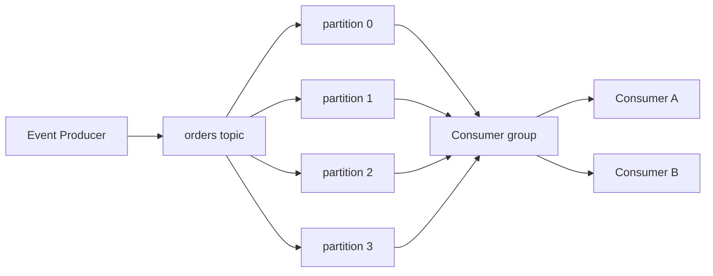

# Kafka Learning Lab

Un laboratoire Java 25 volontairement petit pour apprendre Kafka en manipulant directement le client officiel, sans Spring. Le domaine e-commerce n'est qu'un prétexte : chaque commande rend visibles clé, partition, offset, headers, JSON, consumer group et commit. Il épingle Kafka 4.1.2 (version corrective stable de la branche 4.1) pour le client et l'image officielle.

## Architecture



## Prérequis et démarrage

Java **25**, Maven et Docker Compose sont requis. Démarrer Kafka KRaft :

```bash
docker compose up -d
docker compose logs -f kafka
mvn clean package
java -jar target/kafka-learning-lab-1.0.0-SNAPSHOT.jar topic-create
```

Arrêter : `docker compose down`. Effacer aussi toutes les données (irréversible) : `docker compose down -v`. Vérifier : `topic-info` doit afficher quatre partitions.

## Commandes

```bash
java -jar target/kafka-learning-lab-1.0.0-SNAPSHOT.jar consume
java -jar target/kafka-learning-lab-1.0.0-SNAPSHOT.jar produce --count 100
java -jar target/kafka-learning-lab-1.0.0-SNAPSHOT.jar produce --interactive
java -jar target/kafka-learning-lab-1.0.0-SNAPSHOT.jar produce --count 20 --without-key
java -jar target/kafka-learning-lab-1.0.0-SNAPSHOT.jar replay
java -jar target/kafka-learning-lab-1.0.0-SNAPSHOT.jar topic-info
```

`consume` emploie le groupe `order-processing-group`; par défaut le commit est manuel (`enable.auto.commit=false`) : chaque lot est affiché, puis `commitSync()` est exécuté. `replay` crée un groupe inédit `replay-orders-<timestamp>` et force `earliest`.

Configuration (toutes ont une valeur locale par défaut) : `KAFKA_BOOTSTRAP_SERVERS`, `KAFKA_TOPIC_ORDERS`, `KAFKA_CONSUMER_GROUP`, `KAFKA_AUTO_OFFSET_RESET`, `KAFKA_ENABLE_AUTO_COMMIT`, `KAFKA_ORDERS_PARTITIONS`.

## Parcours d'expérience complet

1. Créer le topic puis lancer `consume` dans un terminal.
2. Produire 100 commandes. Chaque envoi montre partition/offset ; le consumer montre également topic, clé, timestamp et headers.
3. Lancer un deuxième `consume` avec le même groupe. Les messages suivants sont partagés : au plus un consumer du groupe lit une partition. Les logs `Processing partition` et `Partitions revoked` révèlent le rebalance.
4. Arrêter un consumer avec Ctrl+C puis produire à nouveau : ses partitions sont réattribuées.
5. Lancer `replay` : les records retenus sont relus, car les offsets sont propres à ce nouveau groupe.
6. Produire avec et sans clé. Avec clé, `customerId` identique est haché vers la même partition (tant que le nombre de partitions ne change pas) et conserve donc l'ordre pour cette clé. Sans clé, la répartition est pilotée par le producer et ne promet pas cette affinité.
7. Changez `KAFKA_ORDERS_PARTITIONS` puis relancez `topic-create` pour augmenter les partitions et comparer le parallélisme. Kafka ne permet pas de les réduire, et changer ce nombre change le hashage des clés.

Tests unitaires : `mvn test`. Test d'intégration sur un vrai broker KRaft isolé par Testcontainers : `mvn verify -Pintegration` (Docker doit être lancé). Les tests unitaires ne dépendent pas de Docker.

Voir `docs/` pour le cours court et les comparaisons MQ Series prudentes. Tests : `mvn test`. Le test d'intégration réel est le scénario Docker ci-dessus : il utilise le même broker KRaft que les commandes de démonstration; les tests unitaires ne dépendent pas de Docker.
