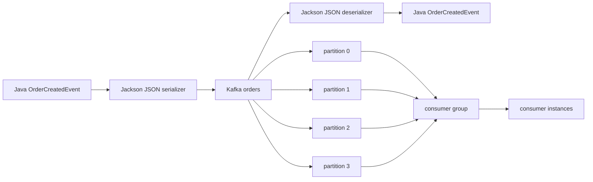

# Architecture

Une seule application et une seule classe de configuration suffisent au MVP. Le producer/consumer manipulent l'API Kafka officielle; les serializers isolent Jackson de la logique métier.
